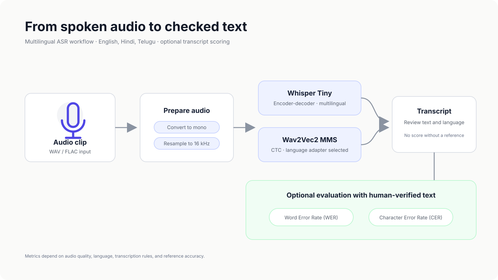
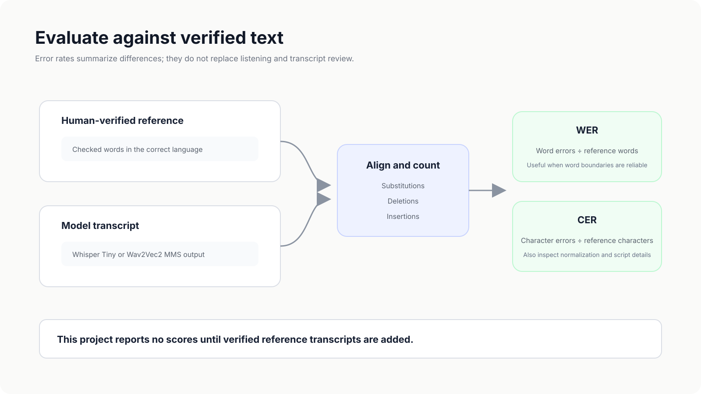

# Multilingual Speech Transcription

A reproducible speech-to-text project that transcribes short English, Hindi, and Telugu audio clips, then optionally measures predictions against a human-verified transcript.

## What this project does

1. Reads a short audio clip and converts it to mono, 16 kHz audio.
2. Transcribes with multilingual Whisper Tiny or Wav2Vec2 MMS.
3. Saves the transcript as text.
4. If reference transcripts are supplied, calculates Word Error Rate (WER) and Character Error Rate (CER) for each clip and reports a macro-average.



## Models

| Model | How it is used | Notes |
| --- | --- | --- |
| Whisper Tiny | Sequence-to-sequence transcription with a selected language | Recommended first run; smaller and easier to run locally. |
| Wav2Vec2 MMS | CTC transcription with a language adapter | Much larger download and memory requirement. The `facebook/mms-1b-all` checkpoint is licensed CC BY-NC 4.0; review its terms and do not use it commercially without separate permission. |

The model cards and implementation details are linked here: [Whisper Tiny](https://huggingface.co/openai/whisper-tiny), [MMS 1B All](https://huggingface.co/facebook/mms-1b-all), and [Hugging Face Whisper documentation](https://huggingface.co/docs/transformers/model_doc/whisper).

## Setup

Use Python 3.10 or 3.11. Install a PyTorch build that matches your computer from the [official PyTorch installation page](https://pytorch.org/get-started/locally/), then install the remaining packages:

```bash
pip install -r requirements.txt
```

The first run downloads the selected model from Hugging Face. Start with Whisper Tiny:

```bash
python transcribe.py --audio data/audio/clip.wav --language hi --model whisper --output outputs/hindi.txt
```

Language codes supported by this starter are `en` (English), `hi` (Hindi), and `te` (Telugu). Add short audio clips that you have permission to use under `data/audio/`; this folder is ignored by Git so personal recordings are not uploaded accidentally.

To try Wav2Vec2 MMS instead:

```bash
python transcribe.py --audio data/audio/clip.wav --language te --model mms --output outputs/telugu.txt
```

MMS uses a 1-billion-parameter checkpoint. Download size, RAM/VRAM, and run time can be substantial; start with Whisper Tiny if you have limited hardware. The MMS checkpoint is non-commercially licensed.

## Evaluate transcription quality



WER and CER require a trusted reference transcript for every clip. Do not score model output against an unverified or guessed transcript. Copy `data/manifest_template.csv` to `data/manifest.csv`, add your audio filenames, language codes, and checked reference text, then run:

```bash
python evaluate.py --manifest data/manifest.csv --model whisper --output outputs/whisper_scores.csv
```

Repeat with `--model mms` to compare the models on the same clips and references. Review the text normalization and punctuation policy before interpreting scores. WER can be misleading for languages where word boundaries are not marked consistently; report CER and inspect examples as well. The macro-average gives each clip equal weight, so include the clip count and dataset description with any result you publish.

No accuracy or error-rate results are included in this repository yet because no audio and verified reference transcripts were supplied with the starter project.

## Repository structure

```text
transcribe.py                 Transcribe one clip
evaluate.py                   Score transcripts against references
data/manifest_template.csv     Evaluation manifest template
assets/asr-workflow.svg        Project workflow figure
outputs/                      Generated transcripts and scores (git-ignored)
```

## Privacy and responsible use

- Obtain consent and permission before recording or processing anyone's voice.
- Keep private audio and transcripts out of public repositories.
- Check the licenses and terms of each model before use; MMS 1B All is non-commercial.
- Treat machine-generated transcripts as drafts. Review names, numbers, and sensitive content by listening to the audio.

## Tools

Python · PyTorch · Hugging Face Transformers · Whisper · Wav2Vec2 MMS · librosa · jiwer
